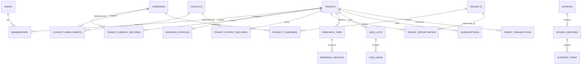

# JENECONK BII — DATABASE DESIGN DOCUMENT
**Version:** 1.0  
**Date:** 8 November 2026  
**Product owner:** Jeneconk Integrated Global Solutions Limited

## 1. Purpose
This document defines the logical relational data model for Jeneconk BII. It supports personal and company workspaces, configurable industries, company/contact/opportunity intelligence, evidence, AI research, CRM, subscriptions and usage credits.

The design is a logical blueprint. It is not a complete executable production schema. Exact column types, constraints, indexes and migrations must be implemented and tested during development.

## 2. Design principles
- PostgreSQL as the primary system of record.
- UUID primary keys for core entities.
- UTC timestamps (`created_at`, `updated_at`) and explicit source retrieval timestamps.
- Tenant-scoped records always carry `tenant_id`.
- Canonical intelligence and tenant-owned CRM records are separate.
- Source provenance, provider restrictions and retention metadata are first-class.
- Soft deletion only where justified; privacy deletion must be real and auditable.
- Use explicit junction tables for many-to-many relationships.
- Avoid uncontrolled JSONB use for core relational concepts.
- All tenant access is enforced in application services; RLS is defence in depth.

## 3. Logical domains
1. Identity and tenancy.
2. Industry configuration.
3. Business profiles and ICP.
4. Company intelligence.
5. Contact intelligence.
6. Projects, tenders and opportunities.
7. Sources, evidence and verification.
8. AI research and lead scoring.
9. CRM and outreach.
10. Billing and metering.
11. Integrations, jobs, notifications and audit.

## 4. Entity relationship overview

## 5. Identity and tenancy tables
### users
- `id` UUID PK
- `auth_provider`, `auth_subject` (unique pair)
- `email_normalised`
- `display_name`
- `status` (active, invited, suspended, deleted)
- `created_at`, `updated_at`, `last_login_at`

Do not use email as the stable identity key. Keep the internal UUID stable if the authentication provider changes.

### tenants
- `id` UUID PK
- `tenant_type` (personal, company)
- `name`, `slug`
- `owner_user_id` FK users
- `status`
- `created_at`, `updated_at`

### memberships
- `id` UUID PK
- `tenant_id` FK tenants
- `user_id` FK users
- `role_id` FK roles
- `status` (invited, active, suspended, left)
- `invited_by_user_id`, `joined_at`
- Unique (`tenant_id`, `user_id`)

### roles / permissions / role_permissions
Define system roles and permission codes. Avoid relying on frontend role labels. Backend checks permission codes for each operation. Custom roles may be added later.

### invitations
- `id`, `tenant_id`, `email_normalised`, `role_id`
- `token_hash`, `expires_at`, `accepted_at`, `invited_by_user_id`
- Store token hashes, not raw invitation tokens.

## 6. Industry configuration
### industries
- `id`, `parent_id` self-FK
- `code`, `name`, `description`
- `is_active`, `sort_order`

### company_types
- `id`, `industry_id`, `code`, `name`, `description`

### job_title_categories
- `id`, `industry_id`, `code`, `name`

### job_title_aliases
- `id`, `category_id`, `alias_normalised`

### opportunity_types
- `id`, `industry_id`, `code`, `name`, `description`

### industry_attributes
- `id`, `industry_id`, `attribute_key`, `label`, `data_type`, `validation_schema`, `is_filterable`

Industry configuration must be versioned or otherwise auditable so that changes do not silently alter historical scores.

## 7. Business Profile and ICP
### business_profiles
- `id`, `tenant_id` unique FK tenants
- `company_name`, `website`, `country_code`
- `business_summary`, `target_regions`
- `profile_status`, `completed_at`

### business_profile_offerings
- `id`, `business_profile_id`
- `offering_type` (product, service, capability)
- `name`, `description`, `category_code`

### business_profile_certifications
- `id`, `business_profile_id`, `name`, `issuer`, `valid_from`, `valid_to`, `evidence_url`

### ideal_customer_profiles
- `id`, `tenant_id`, `name`, `industry_id`, `is_default`, `status`
- `geographies`, `organisation_types`, `size_bands`
- `criteria_config` JSONB for versioned configurable criteria, not arbitrary unvalidated data.

### scoring_templates
- `id`, `industry_id`, `name`, `version`, `is_active`
- `criteria_schema`, `default_weights`, `created_at`

### tenant_scoring_configs
- `id`, `tenant_id`, `icp_id`, `template_id`
- `weights`, `thresholds`, `version`, `effective_from`

## 8. Company intelligence
### companies
Canonical company identity record:
- `id`, `canonical_name`, `normalised_name`
- `description`, `website_domain`, `country_code`
- `record_status`, `created_at`, `updated_at`

Only data that can lawfully be shared across tenants belongs in a shared canonical record. Provider-restricted or customer-private attributes must not be placed here.

### company_aliases
- `id`, `company_id`, `alias`, `alias_normalised`, `source_record_id`

### company_websites
- `id`, `company_id`, `url`, `domain`, `is_primary`, `verified_at`

### company_locations
- `id`, `company_id`, `address_text`, `city`, `region`, `country_code`
- Optional coordinates only when lawfully collected and useful.

### company_industries
- `company_id`, `industry_id`, `classification_source`, `confidence`, `evidence_item_id`

### company_services / company_capabilities
Junction tables linking company to configured service/capability taxonomies. Include source/evidence and confidence.

### tenant_company_records
Tenant-specific saved relationship:
- `id`, `tenant_id`, `company_id`
- `record_status`, `owner_user_id`, `source_context`
- `custom_fields`, `created_at`, `updated_at`
- Unique (`tenant_id`, `company_id`)

This is where a tenant's tags, notes, ownership and CRM state belong.

## 9. Contact intelligence
### contacts
Canonical contact identity:
- `id`, `full_name`, `normalised_name`
- `public_profile_url` where permitted
- `record_status`, `created_at`, `updated_at`

### contact_employments
- `id`, `contact_id`, `company_id`
- `job_title`, `job_title_category_id`
- `start_date`, `end_date`, `is_current`
- `source_record_id`, `confidence`

### contact_channels
- `id`, `contact_id`, `channel_type` (work_email, phone, profile)
- `value_encrypted` where appropriate, `value_hash` for matching
- `verification_status`, `verified_at`, `source_record_id`
- `permitted_use`, `retention_until`

### tenant_contact_records
- `id`, `tenant_id`, `contact_id`, `company_id`
- `owner_user_id`, `tags`, `notes`, `status`
- Unique constraint appropriate to tenant/contact/company.

### suppression_records
- `id`, `tenant_id` nullable only for global legally required suppression
- `channel_type`, `value_hash`, `reason`, `created_at`
- `source` and scope must be explicit. Suppression must be checked before outreach.

## 10. Projects, tenders and opportunities
### projects
- `id`, `canonical_title`, `description`
- `industry_id`, `project_type`, `location`
- `status`, `announced_at`, `expected_start_at`, `expected_end_at`
- `estimated_value`, `currency_code`, `value_confidence`
- Do not infer or fabricate project values or status.

### project_companies
- `project_id`, `company_id`, `relationship_type` (operator, EPC, contractor, supplier, partner)
- `source_record_id`, `confidence`

### project_events
- `id`, `project_id`, `event_type`, `event_date`, `description`, `source_record_id`

### procurement_notices
- `id`, `industry_id`, `title`, `buyer_company_id`
- `notice_reference`, `published_at`, `deadline_at`
- `status`, `source_record_id`, `source_url`

### tenders
- `id`, `procurement_notice_id`, `tender_type`, `scope_summary`
- `eligibility_summary`, `deadline_at`, `status`

### tenant_opportunities
- `id`, `tenant_id`, `project_id` nullable, `procurement_notice_id` nullable
- `owner_user_id`, `status`, `fit_score`, `notes`, `next_action_at`
- Tenant pipeline state must not be shared across tenants.

## 11. Sources, evidence and verification
### sources
- `id`, `name`, `source_type` (official, provider, company_site, news, user_upload, other)
- `base_url`, `licence_class`, `terms_reference`
- `default_retention_days`, `allowed_purposes`, `redistribution_allowed`
- `is_active`

### source_records
- `id`, `source_id`, `external_record_id`
- `canonical_url`, `retrieved_at`, `published_at`
- `raw_payload_location` (if retained and permitted)
- `content_hash`, `tenant_id` nullable for approved shared records
- `retention_until`, `licence_metadata`

### evidence_items
- `id`, `source_record_id`, `claim_type`, `claim_text`
- `entity_type`, `entity_id` (polymorphic reference)
- `confidence`, `supporting_excerpt`, `created_at`

For strict database referential integrity, use entity-specific evidence junction tables or a typed target design instead of relying solely on a polymorphic `entity_type/entity_id` pair. Validate any polymorphic reference in application services.

### verification_events
- `id`, `entity_type`, `entity_id`, `field_name`
- `verification_method`, `result`, `verified_at`, `source_record_id`
- `performed_by` (system/provider/user)

### data_change_history
- `id`, `entity_type`, `entity_id`, `field_name`
- `old_value_hash`, `new_value_hash`, `change_source`, `changed_at`

## 12. Research and lead scoring
### research_jobs
- `id`, `tenant_id`, `requested_by_user_id`
- `subject_type`, `subject_id`, `job_type`, `status`
- `provider_budget`, `idempotency_key`, `created_at`, `started_at`, `completed_at`

### research_results
- `id`, `research_job_id`, `summary`, `structured_output`
- `model_provider`, `model_name`, `prompt_version`
- `confidence`, `created_at`

### research_result_evidence
- `research_result_id`, `evidence_item_id`, `claim_key`

### lead_scores
- `id`, `tenant_id`, `icp_id`, `subject_type`, `subject_id`
- `score_total`, `confidence`, `scoring_version`, `scored_at`

### lead_score_components
- `id`, `lead_score_id`, `criterion_code`
- `weight`, `raw_score`, `weighted_score`, `explanation`
- `evidence_item_ids` or a dedicated junction table.

Store score snapshots so historic scores remain interpretable after templates change.

## 13. CRM and outreach
### lead_lists
- `id`, `tenant_id`, `name`, `description`, `created_by_user_id`

### crm_leads
- `id`, `tenant_id`, `lead_list_id`
- `company_id`, `contact_id` nullable, `opportunity_id` nullable
- `stage_id`, `owner_user_id`, `lead_status`, `created_at`, `updated_at`

### pipeline_stages
- `id`, `tenant_id`, `name`, `sort_order`, `is_closed`, `outcome_type`

### activities
- `id`, `tenant_id`, `crm_lead_id`, `activity_type`
- `subject`, `body`, `occurred_at`, `created_by_user_id`

### tasks
- `id`, `tenant_id`, `crm_lead_id`, `assigned_to_user_id`
- `title`, `due_at`, `status`, `priority`

### notes
- `id`, `tenant_id`, `entity_type`, `entity_id`
- `body`, `created_by_user_id`, `created_at`

### outreach_drafts
- `id`, `tenant_id`, `crm_lead_id`, `contact_id`
- `channel`, `subject`, `body`, `evidence_snapshot`
- `status` (draft, approved, sent, cancelled)
- `approved_by_user_id`, `approved_at`, `sent_at`

Only approved drafts may be passed to a sending integration. Store opt-out and suppression checks with send attempts.

## 14. Billing and metering
### plans
- `id`, `code`, `name`, `billing_period`, `base_price`, `currency_code`, `is_active`

### plan_entitlements
- `id`, `plan_id`, `feature_code`, `limit_value`, `limit_period`

### subscriptions
- `id`, `tenant_id`, `plan_id`, `provider_subscription_id`
- `status`, `current_period_start`, `current_period_end`, `cancel_at_period_end`

### credit_accounts
- `id`, `tenant_id`, `balance`, `currency_or_unit_code`, `updated_at`

### credit_transactions
- `id`, `tenant_id`, `credit_account_id`
- `transaction_type`, `amount`, `balance_after`
- `reference_type`, `reference_id`, `idempotency_key`, `created_at`

### provider_usage_events
- `id`, `tenant_id`, `provider_id`, `operation`
- `units`, `estimated_cost`, `actual_cost`, `currency_code`
- `request_id`, `occurred_at`

### ai_usage_events
- `id`, `tenant_id`, `model_provider`, `model_name`
- `input_tokens`, `output_tokens`, `estimated_cost`, `task_type`, `occurred_at`

Billing events must be idempotent. Never derive a balance only from a mutable counter; retain an immutable transaction ledger and reconcile account balance.

## 15. Integrations, jobs, notifications and audit
### providers
- `id`, `code`, `name`, `provider_type`, `status`

### integration_accounts
- `id`, `tenant_id`, `provider_id`
- `credentials_secret_ref`, `status`, `configured_by_user_id`
- Never store plaintext API keys in ordinary database columns.

### background_jobs
- `id`, `tenant_id`, `job_type`, `payload`
- `status`, `priority`, `attempt_count`, `max_attempts`
- `available_at`, `locked_at`, `locked_by`, `last_error`
- `idempotency_key`, `created_at`, `completed_at`

### notifications
- `id`, `tenant_id`, `user_id`, `type`, `payload`
- `read_at`, `created_at`

### saved_searches
- `id`, `tenant_id`, `created_by_user_id`, `name`
- `search_definition`, `schedule`, `is_active`

### audit_logs
- `id`, `tenant_id` nullable for platform events
- `actor_user_id`, `action`, `resource_type`, `resource_id`
- `ip_metadata`, `user_agent`, `metadata`, `created_at`

Do not put passwords, API secrets, full sensitive payloads or unnecessary personal data in audit logs.

## 16. Data classification and sharing
Use explicit classification metadata for records and fields:
- `SHARED_PERMITTED`: may be reused across tenants under applicable source terms.
- `TENANT_RESTRICTED`: visible only to the tenant that acquired/created it.
- `PROVIDER_RESTRICTED`: use/display/storage constrained by provider contract.
- `PRIVATE_USER`: private to an individual user/workspace.

Do not assume that a record is shareable merely because it is public. Sharing is governed by source terms, applicable law and product policy.

## 17. Indexing and constraints
Initial indexes:
- `memberships(tenant_id, user_id)` unique.
- `tenant_company_records(tenant_id, company_id)` unique.
- `crm_leads(tenant_id, stage_id, owner_user_id)`.
- `companies(normalised_name)` and trigram GIN index where needed.
- `company_locations(country_code, region, city)`.
- `projects(industry_id, status, announced_at)`.
- `procurement_notices(deadline_at, status)`.
- `background_jobs(status, available_at, priority)`.
- `credit_transactions(tenant_id, created_at)`.
- `audit_logs(tenant_id, created_at)`.

Use foreign keys, check constraints, uniqueness and partial indexes for active records. Avoid over-indexing write-heavy tables.

## 18. Tenant isolation and access control
- Every tenant-owned table has a non-null `tenant_id`, except explicitly global reference data.
- Resolve tenant membership and permissions on the server.
- Use composite constraints where useful to prevent cross-tenant references.
- Apply PostgreSQL RLS as a second barrier for tenant-owned data.
- Background workers must establish tenant context and use least-privilege database roles.
- Exports, files, caches, search results and notifications must preserve tenant boundaries.
- Automated tests must attempt cross-tenant read, update, delete and export.

## 19. Retention, correction and deletion
- Retention periods depend on source terms, purpose and applicable law.
- Expire or delete provider data when required by contract.
- Provide workflows for correction, deletion and marketing objection.
- Preserve minimal audit evidence where legally justified without retaining unnecessary deleted content.
- Deletion must propagate to derived records, caches, search indexes, exports and downstream processors where required.
- Maintain a documented backup expiry process.

## 20. Migration and implementation order
1. Users, tenants, roles, permissions, memberships, invitations.
2. Industry taxonomies and configurable attributes.
3. Business profiles, offerings, ICP and scoring templates.
4. Companies, aliases, locations, industry links and tenant company records.
5. Sources, source records, evidence and verification.
6. Contacts, employment, channels, tenant contact records and suppression.
7. Projects, procurement notices, tenders and tenant opportunities.
8. Research jobs/results and score snapshots.
9. CRM lists, leads, stages, activities, tasks, notes and outreach drafts.
10. Plans, subscriptions, credit ledger and usage events.
11. Providers, integrations, jobs, notifications, saved searches and audit logs.

Use Alembic migrations. Every migration must be reviewed, tested against a representative database and have a rollback or forward-repair strategy.

## 21. Implementation cautions
- The ERD and field lists are logical, not final SQL.
- Do not store arbitrary external raw payloads indefinitely.
- Decide whether shared company/contact canonicalisation is permitted before implementing global records.
- Avoid using JSONB as a substitute for relational structure.
- Polymorphic references need explicit validation or junction tables.
- Protect contact channels and provider-sourced data according to contractual and legal requirements.
- Never let a tenant modify canonical shared records directly.
